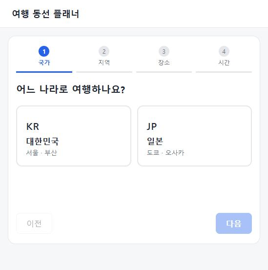
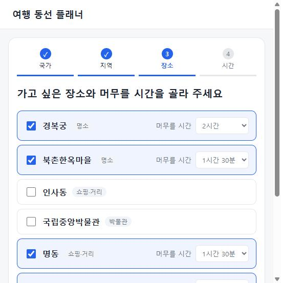
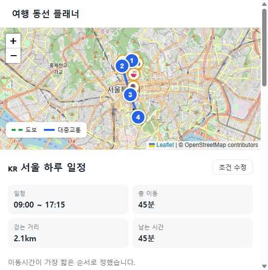

# PLAN:J — 여행 동선 플래너

장소와 시간만 고르면 방문 순서·이동 경로·식사 시간까지 넣은 하루 일정을 만들어 주는 모바일 웹앱입니다.

🔗 [서비스 바로가기](https://trabel-1.vercel.app)

| 나라 선택 | 장소 고르기 | 결과 지도 |
| --- | --- | --- |
|  |  |  |

## 실행

```bash
npm install
npm run dev        # http://localhost:5173
npm run build      # dist/ 에 배포용 파일
npm run i18n:check # 한국어 문구에 영어 번역이 빠지지 않았는지 확인
```

키 설정은 `.env.example`을 `.env.local`로 복사해서 채웁니다. 자세한 내용은 [docs/API_KEYS.md](docs/API_KEYS.md)에 있습니다.

## 폴더 안내

```
trip-route-planner/
├─ src/                    앱 코드
│  ├─ App.tsx              화면 전환·상태를 묶는 최상위 컴포넌트
│  ├─ pages/               하단 탭으로 들어가는 화면
│  │  ├─ Wizard.tsx        일정 만들기 (나라 → 장소 → 숙소 → 시간)
│  │  ├─ CommunityPage.tsx 커뮤니티 피드·글쓰기
│  │  ├─ MessagesPage.tsx  1:1 메시지
│  │  ├─ MyPage.tsx        내 여행·찜한 여행
│  │  └─ AuthPage.tsx      로그인·회원가입·계정 설정
│  ├─ components/          화면 안에서 쓰는 부품 (창, 지도, 검색 등)
│  │  └─ steps/            일정 만들기의 단계별 입력
│  ├─ hooks/               React 상태 훅 (여행·찜·게시글·메시지함 등)
│  ├─ lib/                 화면과 무관한 로직 (일정 계산, 저장, 로그인, 공유 이미지)
│  ├─ services/            외부 API (Google 지도·장소, 경로, Supabase)
│  ├─ data/                나라·장소 목록, 통화, 예시 게시물
│  └─ i18n/                한/영 문구
├─ public/                 그대로 배포되는 파일 (아이콘, 나라 사진, 푸시 서비스 워커)
├─ supabase/               DB 스키마·마이그레이션, Edge Function (경로 중계, 메시지 푸시)
├─ docs/                   설정 안내 문서, 데이터 구조, 로드맵
├─ docker/                 Docker 이미지 (Dockerfile, nginx 설정)
├─ scripts/                개발용 스크립트 (번역 누락 검사)
└─ screenshots/            README용 화면 캡처
```

## Docker

```bash
docker build -f docker/Dockerfile -t trabel_1 .
docker run -p 8080:80 --env-file .env.local trabel_1   # http://localhost:8080
```
